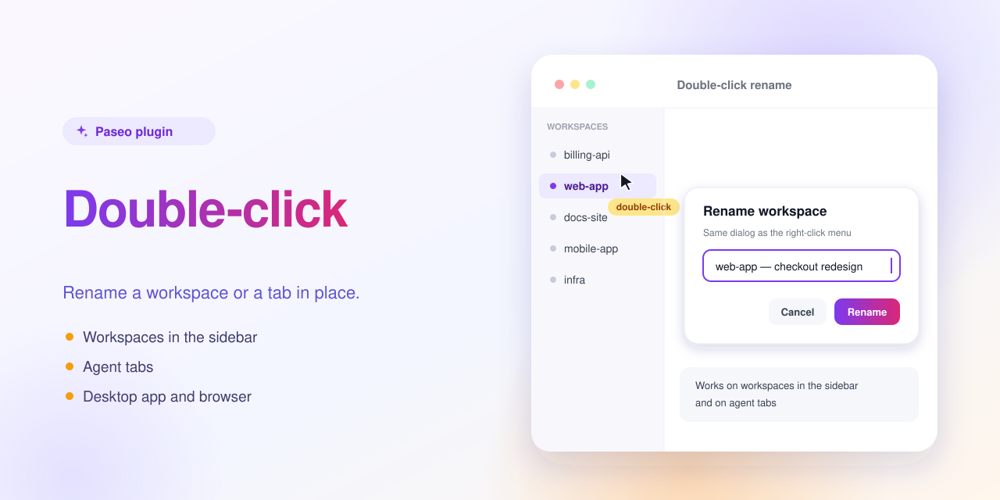

# Double-click rename — a Paseo plugin



Double-click a workspace or an agent tab to rename it.

Double-click a workspace in the sidebar or an agent tab and the same Rename dialog opens as from the right-click menu. It works in the desktop app and the browser, not on mobile.

## Install

Requires Paseo 0.13.0 or later.

```bash
paseo plugin install https://github.com/puchkoff/paseo-2click-rename
```

Or from a local clone: `paseo plugin install ./paseo-2click-rename`. Check with `paseo plugin ls`.

## Develop

```bash
npm install
npm run typecheck
```

The in-app description shown by Paseo lives in [OVERVIEW.md](OVERVIEW.md).
